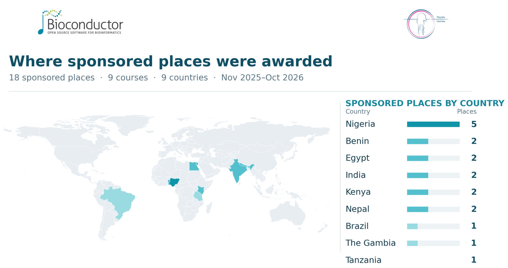

{fig-alt="World map showing 18 sponsored course places across nine countries from November 2025 to October 2026: Nigeria 5; Benin, Egypt, India, Kenya and Nepal 2 each; Brazil, The Gambia and Tanzania 1 each." fig-align="center" width="100%"}

What difference can a sponsored place on a bioinformatics course make? For some researchers, it means access to training they would otherwise struggle to afford. For others, it is an opportunity to explore a new field, work through unfamiliar analytical methods, or find new ways to approach an existing research question.

Through the [Bioconductor–Physalia collaboration](https://blog.bioconductor.org/posts/2025-06-20-physalia-collaboration/), Physalia offers two free places on eligible courses to researchers based in low- and middle-income countries (LMICs). The Bioconductor Community Manager coordinates the application process and works with the [Training Committee](https://training.bioconductor.org/) co-chairs on selecting participants, while Bioconductor helps promote the courses through its community channels. Between November 2025 and October 2026, the programme provided 18 sponsored places across nine courses, covering topics ranging from RNA-seq and proteomics to microbiome analysis, epigenomics and network biology.

The aim is to make specialist training more accessible to researchers who might otherwise miss out on these opportunities. We asked participants what they found useful about their courses and how they planned to use what they had learned. Their responses offer a glimpse into the different ways the training connects with their work.

## Making training accessible

Access was a recurring theme in the feedback. For Blessing Chioma Oselu, a PhD student and Bioinformatics Research Assistant at Covenant University in Nigeria, the opportunity to attend the *Single-cell RNA-seq Analysis with R/Bioconductor* course meant learning directly from experts and having structured materials to return to afterward.

"The access to expert teaching and the structured materials were the most valuable parts for me," she wrote.

Blessing plans to continue working through the recorded sessions at her own pace. For researchers balancing training with other commitments, being able to revisit course material can be just as useful as attending the live sessions.

Another participant, from Benin, came to the *Epigenomics Data Analysis* course without previous experience in the subject. The step-by-step walkthroughs of methods including ChIP-seq and ATAC-seq helped make the material more manageable.

"I left the course at a clearly higher level than I started, and I feel ready to work with my own data when the time comes," the participant reflected.

They also noted that opportunities like this are rare where they are based, and that support from Bioconductor and Physalia made a real difference.

## Taking new methods back to research

Participants also described how the training related to questions they were already working on, or hoped to explore.

For Amira M. F. Abozaid, a PhD student and Assistant Lecturer at Alexandria University and E-JUST in Egypt, the *RNA-seq data analysis with R/Bioconductor* course provided a deeper understanding of the RNA-seq workflow, from quality control and normalization to differential expression and visualization.

Amira wrote that she had already started applying the workflows to her cancer genomics projects and sharing the skills with colleagues and students at her home institutions.

Other participants were looking at different applications. Idris Ishola Adejumobi, a Research Associate at the International Institute of Tropical Agriculture in Nigeria, described how the *Epigenomics Data Analysis* course broadened his understanding of how epigenetic variation can influence complex traits and complement genomic information in crop improvement. He also identified further training in the integration of epigenomic, genomic, and transcriptomic data as a useful next step for agricultural and plant-breeding research.

Rabiath Adigoun, a postdoctoral researcher at the University of Abomey-Calavi in Benin, highlighted the relevance of *Orchestrating Microbiome Analysis with Bioconductor* to her ongoing and future research on plant microbiomes.

"The expertise and methodological skills I have acquired will substantially strengthen my ongoing and future research on the plant microbiome in Benin and across Africa," she wrote.

Sally Karimi Kinyua, a Research Assistant based in Kenya, attended the Network Analysis in Systems Biology with R/Bioconductor course. She hopes to apply what she learned about gene networks to research into mutations associated with malaria resistance. Sally also highlighted how the sponsored place gave her access to training that would otherwise have been out of reach because of limited resources.

These examples span different fields, but the underlying theme is similar: participants are looking for ways to connect computational methods with the biological questions they want to answer.

## Learning to work with unfamiliar data

Sometimes, what matters most is finding a way into a subject that initially seems difficult.

A participant in the *Statistical Methods for Metatranscriptomics* course described how the practical sessions helped make complex concepts easier to follow. They particularly appreciated the explanations of foundational terminology before moving on to more technical material.

The course also introduced them to ways of analysing microbial gene expression data using computational tools and reproducible workflows. Coming from a bachelor's degree background, they described it as one of their first deeper exposures to this area of bioinformatics.

Another participant, Binod Rayamajhee, a Research Fellow at the Kathmandu Research Institute for Biological Sciences in Nepal, highlighted the course's combination of conceptual teaching and practical work with Bioconductor tools.

The training relates directly to his work in microbiome data analysis, and he anticipates applying the methods to study host–microbe interactions in bowel disease models.

Binod also hopes to share what he learned through workshops and one-to-one mentoring with colleagues and junior researchers, particularly those working in resource-limited settings.

## Sharing what comes next

Knowledge sharing appeared in several participants' reflections, whether through helping colleagues, teaching students, or bringing new analytical approaches into research groups.

Sandra Achieng Otieno, an MSc student at icipe in Kenya, attended the microbiome analysis course. She was particularly interested in learning how to structure microbiome data using TreeSummarizedExperiment and how different transformations can affect downstream analyses, including diversity estimation and ordination.

She hopes to apply these skills to research combining microbiome data with target gene expression and elemental analysis.

As Sandra put it, the course gave her "a clearer framework for integrating multi-omics biological data in a structured and reproducible way."

For others, training may also open the door to contributing to Bioconductor itself. Marco Antonio Campanário Sampaio, a PhD student in Brazil who attended the Developing R/Bioconductor Packages for Genomics course, wrote, "I hope to become a contributor to the Bioconductor community soon."

These are plans at different stages, and their longer-term outcomes remain to be seen. Still, it is useful to hear participants identify specific methods they want to try, datasets they want to analyse, and colleagues with whom they hope to share their knowledge.

## Continuing the conversation

The feedback collected so far gives us a better sense of what participants value in specialist bioinformatics training. Expert teaching and well-organised materials matter, as do practical exercises that make unfamiliar methods easier to approach. Just as importantly, participants want to connect what they learn to their own research.

We would like to thank everyone who shared their reflections, along with the instructors and organisers who contributed to the courses. We'd also like to thank Laurah Nyasita Ondari for helping promote these opportunities through Bioconductor's social media channels.

We hope to hear from participants again as they put their new skills into practice. In the meantime, their experiences offer a useful reminder of why access to training matters: it gives researchers more opportunities to learn new methods, explore their research questions, and contribute to the scientific communities around them.

For the full list of the Physalia courses and workshops, please visit [www.physalia-courses.org](https://www.physalia-courses.org). To find out more about the collaboration, explore the [Bioconductor-Physalia course listings](https://training.bioconductor.org/collaborations/physalia/), including upcoming courses and how to apply for a sponsored place.

Interested in developing or teaching a Bioconductor-related course? Physalia welcomes ideas from potential instructors and is happy to discuss possible topics, content and formats. [Get in touch with Physalia](https://www.physalia-courses.org/contact/) to explore an idea.

*This article is also published on the [Physalia website](https://www.physalia-courses.org/courses-workshops/blogpost/).*

