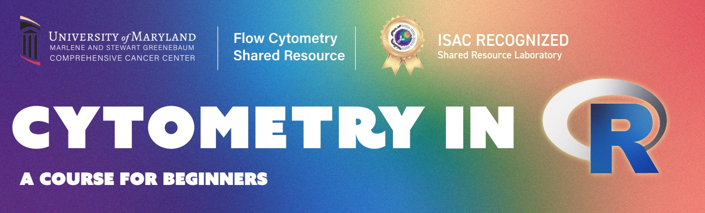

Flow cytometry researchers have a growing collection of R and Bioconductor tools available to them. But for someone who is comfortable working with cytometry data and has little programming experience, knowing where to begin can be difficult. That is the gap the free Cytometry in R course aims to fill.

## A starting point for cytometry researchers

Developed by David Rach and colleagues at the Flow Cytometry Shared Resource of the University of Maryland Greenebaum Comprehensive Cancer Center, Cytometry in R began in February 2026 as a free weekly course for people with cytometry experience but little or no coding background.

The course starts with practical foundations, including setting up R, working with GitHub and installing packages, before moving into data handling, visualisation and cytometry analysis workflows. Sessions are offered online and in person, with recordings, code and teaching materials openly available. Learners can work through the materials at their own pace and ask questions through GitHub Discussions.

The response has been encouraging. In his [BioC2026 presentation](https://youtu.be/krVI-HXm4_w?si=E3fzttBKJr2zFHfI&t=1475), David reported close to 2,000 expressions of interest worldwide and several hundred viewers for individual weekly topics.

[Explore the course materials and schedule](https://umgcccfcsr.github.io/CytometryInR/Schedule.html) | [Watch course recordings](https://youtube.com/playlist?list=PL7tGF31b_cVqEkSLFvAX3kbtzUVpMe-VB&si=nsC9Wmg_Jvc5uVG3)

## What comes after the introductory course?

At the October 2026 [Bioconductor Training Committee](https://training.bioconductor.org) meeting, David described an opportunity to build on the course. It introduces many cytometry packages, but a gap remains between the introductory training and the knowledge needed to work through some individual package vignettes.

Additional materials addressing these gaps could help. Package authors, experienced users and instructors might contribute worked examples, reproducible case studies or step-by-step tutorials. These could help learners explore packages beyond those covered by the course and apply them to their own research questions.

## Connecting course participants and package developers

David, who recently joined Bioconductor’s [Community Advisory Board](https://bioconductor.org/about/community-advisory-board/), now coordinates the newly established [Bioconductor Cytometry Working Group](https://workinggroups.bioconductor.org/currently-active-working-groups-committees.html#cytometry), which aims to support community efforts around documentation and longer-term maintenance of packages for conventional, spectral, imaging and mass cytometry.

His plan is to reconnect with package developers, understand their priorities and identify where additional documentation or support would be welcome. One possibility is a focused writing or documentation sprint, bringing interested Cytometry in R participants together with package maintainers to work on specific, manageable tasks.

This could give learners a supported route into contributing: learning to use a package, gaining confidence with its documentation and examples, and helping improve the experience for the next person.

## Get involved

There are several ways to contribute, depending on your experience and interests:

- **Package developers** could identify documentation gaps and suggest tasks where community input would be welcome.
- **Experienced users and instructors** could develop tutorials, examples or bridging materials for learners ready to explore further.
- **Course participants** could test instructions, point out confusing steps and take part in supported documentation activities as these develop.

Interested in joining or following the discussions? [Join Bioconductor Zulip](https://community-bioc.zulipchat.com/join/5pgmjejclfuvidu5dbu46xqw/) and subscribe to the **cytometry** channel to introduce yourself, share ideas and help shape the group’s first activities. Users, learners, instructors and package developers are all welcome.

For questions about the course itself, the [Cytometry in R GitHub Discussions](https://github.com/UMGCCCFCSR/CytometryInR/discussions) remain a place to connect with instructors and fellow learners.

The course offers an accessible starting point for cytometry researchers new to R. The working group provides a way to build on that learning and contribute to the tools and resources the community relies on.
