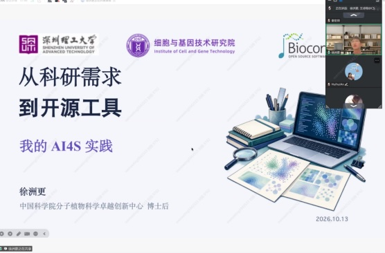

With [BiocAsia 2026](https://biocasia2026.bioconductor.org/) coming up in Melbourne, community members have been organising seminars and exploring ways to take part locally.

More than 200 people joined the latest [BiocAsia seminar](https://biocasia2026.bioconductor.org/seminars/) on 13 October. The session ran for two and a half hours, with discussion continuing well beyond the planned finish. It was the first seminar in the series hosted from China, with Mandarin as the main language. Shixiang Wang spoke about building an open-source ecosystem around UCSC Xena and visualisation tools, and Zhougeng Xu shared his experience developing open-source tools for AI in science.

The seminar was organised by Zuguang Gu, a member of the [Bioconductor Community Advisory Board](https://bioconductor.org/about/community-advisory-board/) and an active BiocAsia contributor based in China. The next seminar will take place in December.

<!--
{fig-alt="Describe what the image shows." fig-align="center"}
-->

Alongside the seminars, Jyoti Bhogal and Malvika Kharbanda have been discussing watch party options in India for BiocAsia 2026. The aim is to give people who cannot travel to Melbourne a chance to take part in the conference and meet others nearby.

Join us at [BiocAsia 2026](https://biocasia2026.bioconductor.org/) on **19 and 20 November at RMIT City Campus, Melbourne**, for workshops, talks and a chance to meet others working with R and Bioconductor. [**Registration is open**](https://biocasia2026.bioconductor.org/registration/), and we’d love to see you there.

To keep in touch between events, [join the **BiocAsia channel on Bioconductor Zulip**](https://community-bioc.zulipchat.com/join/cr4isltci5v232hkkrhti656/). It’s a place to hear about future seminars, discuss watch parties and share ideas for other activities.

A big thank you to the speakers, organisers and everyone giving their time to make these activities happen.