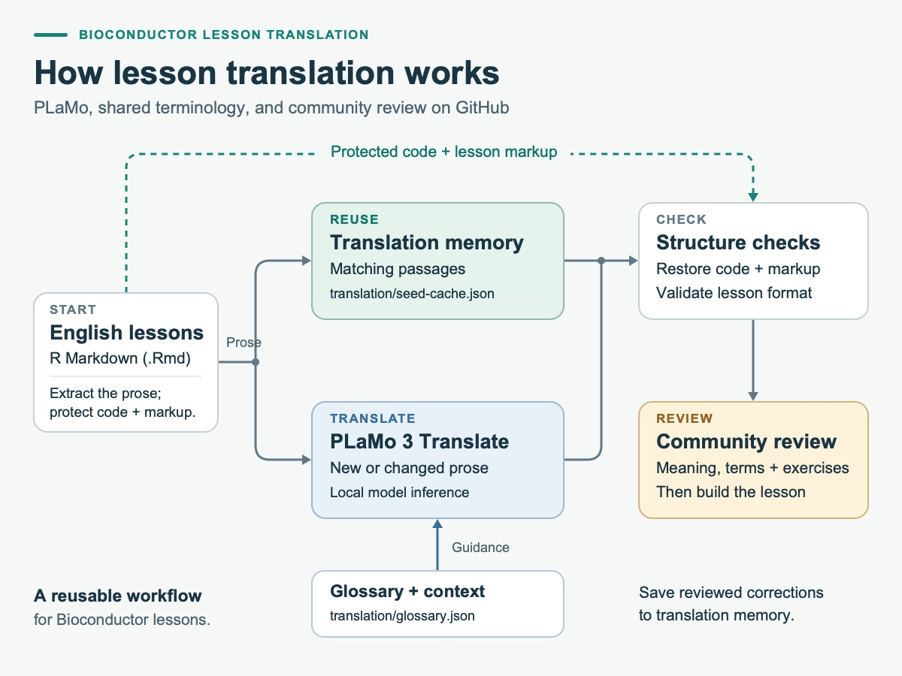

In the [report on our Japanese workshops](https://blog.bioconductor.org/posts/2026-11-12-japanese-carpentries-workshops/),
I explained why our Crowdin integration had become difficult to maintain.
Keeping executable R Markdown lessons in sync required file conversions,
translation synchronisation and reconstruction of buildable lessons. I remain
grateful for Crowdin's support. We are now moving to PLaMo-based AI translation
directly in the lesson repositories, with code and markup protected and
community review on GitHub.

I am introducing a new AI-assisted translation workflow in the
[bioconductor-translations](https://github.com/bioconductor-translations)
organisation, built around PLaMo 3 Translate and review on GitHub. The first
lesson is
[*Introduction to data analysis with R and Bioconductor*](https://carpentries-incubator.github.io/bioc-intro/),
with published editions in Japanese, Spanish, Simplified Chinese, French and
Urdu. These editions are open for community review and improvement.

## What is PLaMo 3 Translate?

PLaMo 3 Translate is a family of large language models developed by Preferred
Networks (PFN) specifically for translation. PFN's November 5, 2026 technical
article,
[*PLaMo 3 Translate: World-Class Translation with Open Weights—Here's How We Built It*](https://www.preferred.jp/en/blog/tech/plamo-3-translate-weight-release),
explains the development process and the release of downloadable model
weights.

PFN trains the models on source–translation pairs and further refines them to
prefer better translations. Smaller models also learn from the 31B model
through distillation. The family supports 53 languages and can take surrounding
context and a glossary into account. These features fit our lesson workflow:
we can supply nearby explanations and preferred technical terminology when
translating a passage.

The models come in four sizes: 0.8B, 2B, 8B and 31B parameters. Our workflow uses
[`pfnet/plamo-3-translate-8b-MLX-4bit`](https://huggingface.co/pfnet/plamo-3-translate-8b-MLX-4bit),
the 8B model in a 4-bit MLX format that reduces memory use for local generation
on Apple silicon Macs. The model weights are distributed under the PLaMo
Community License.

## Explore the five language editions

The introductory lesson covers organising data in spreadsheets, using R and
RStudio, manipulating data with `dplyr`, and visualising data. Each language
edition has a lesson website for learners and a repository for contributors:

| Language | Read the lesson | Contribute on GitHub |
|:--|:--|:--|
| Japanese | [Japanese lesson](https://bioconductor-translations.github.io/bioc-intro-plamo3translate-ja/) | [bioc-intro-plamo3translate-ja](https://github.com/bioconductor-translations/bioc-intro-plamo3translate-ja) |
| Spanish | [Spanish lesson](https://bioconductor-translations.github.io/bioc-intro-plamo3translate-es/) | [bioc-intro-plamo3translate-es](https://github.com/bioconductor-translations/bioc-intro-plamo3translate-es) |
| Simplified Chinese | [Simplified Chinese lesson](https://bioconductor-translations.github.io/bioc-intro-plamo3translate-zh-hans/) | [bioc-intro-plamo3translate-zh-hans](https://github.com/bioconductor-translations/bioc-intro-plamo3translate-zh-hans) |
| French | [French lesson](https://bioconductor-translations.github.io/bioc-intro-plamo3translate-fr/) | [bioc-intro-plamo3translate-fr](https://github.com/bioconductor-translations/bioc-intro-plamo3translate-fr) |
| Urdu | [Urdu lesson](https://bioconductor-translations.github.io/bioc-intro-plamo3translate-ur/) | [bioc-intro-plamo3translate-ur](https://github.com/bioconductor-translations/bioc-intro-plamo3translate-ur) |

Our Crowdin project also received Portuguese translation contributions, and I
am grateful to everyone who contributed them. I am sorry that Portuguese is
not included among these editions: the PLaMo translation model we currently
use does not support Portuguese, which is absent from its
[supported-language list](https://huggingface.co/pfnet/plamo-3-translate-8b#supported-languages).

Translation coverage and review are still in progress. Some setup pages and
interface labels remain in English. At the time of writing, the published
Urdu episodes are available, but that repository's
[updater configuration](https://github.com/bioconductor-translations/bioc-intro-plamo3translate-ur/blob/main/translation/config.json)
and translation guide still refer to Japanese and need adaptation before
being used to regenerate Urdu text.

## How the translation system works

{#fig-translation-workflow fig-alt="Workflow diagram: English lesson prose either reuses matching translation memory or is translated locally by PLaMo using a glossary and context. Protected code and lesson markup bypass generation. The reassembled lessons undergo structure checks, community review and a build. Reviewed corrections are saved to translation memory." fig-align="center" width="1200"}

1. **Read an English source revision.** The translator reads the upstream
   lesson's R Markdown files from a Git revision without checking it out over
   the translated working files.
2. **Reuse matching translations.** Each translation repository stores its
   versioned translation memory in `translation/seed-cache.json`. This JSON file
   stores previous translations and review statuses by source passage and
   episode. Matching records can be reused, while new or changed prose is sent
   to the model.
3. **Guide terminology and protect structure.** A language-specific glossary
   and contextual guidance help disambiguate terms. Code blocks, inline code,
   link destinations and lesson markup are protected during translation, and
   structural checks run before lesson files are replaced.
4. **Review and build.** Maintainers inspect the translated text and memory
   changes, build the lesson, and commit the reviewed result. The translator
   itself does not commit or push changes.

### Shared terminology in glossary.json

Each repository keeps its preferred terminology in `translation/glossary.json`.
For example, the Japanese repository's
[translation/glossary.json](https://github.com/bioconductor-translations/bioc-intro-plamo3translate-ja/blob/main/translation/glossary.json)
contains `source` and `target` term pairs, mapping "data frame" to
"データフレーム" and keeping "Bioconductor" unchanged. The translator passes
these pairs to the model to guide terminology consistently across episodes.
Contributors can propose glossary changes through pull requests. A glossary
change requires fresh generation for machine records on the next update;
matching `reviewed` records retain their wording, so terminology corrections
must also be applied to the reviewed translation memory where needed.

### Update a translation yourself

To update a translation yourself, follow `translation/README.md` in the
repository for your language. These documents cover environment setup,
fetching the English source, previewing changes, generating translations,
reviewing the results and building the lesson:

- Japanese: [translation/README.md](https://github.com/bioconductor-translations/bioc-intro-plamo3translate-ja/blob/main/translation/README.md)
- Spanish: [translation/README.md](https://github.com/bioconductor-translations/bioc-intro-plamo3translate-es/blob/main/translation/README.md)
- Simplified Chinese: [translation/README.md](https://github.com/bioconductor-translations/bioc-intro-plamo3translate-zh-hans/blob/main/translation/README.md)
- French: [translation/README.md](https://github.com/bioconductor-translations/bioc-intro-plamo3translate-fr/blob/main/translation/README.md)

For Urdu, the updater configuration and documentation caveat above still
applies.

For example, in the Japanese repository, after configuring the upstream remote
as described in its guide, a maintainer can run:

```bash
git fetch upstream main
uv run --locked scripts/translate.py --source-ref upstream/main --dry-run
uv run --locked scripts/translate.py --source-ref upstream/main --update-memory
git diff -- episodes translation
Rscript scripts/build.R
```

The dry run shows which passages can be reused and which need translation,
without generating new text or writing lesson files. The `--update-memory`
option saves new translation records to `translation/seed-cache.json` and
source provenance to `translation/source-manifest.json` for review. The local
runtime cache under `.cache/translation/` is ignored by Git. Other editions may
use a different remote name, so follow `translation/README.md` in the
repository you are updating.

The translator also checks for local edits and stops before overwriting an
edited lesson. Small build adaptations are recorded separately with checks
against the expected source. Images, datasets and episode ordering still need
separate maintenance when the English lesson changes.

## Local generation, reusable community knowledge

The workflow pins the model revision and locks its Python dependencies,
recording the source revision and model provenance with the translation
resources.

Generating new translations with the current implementation requires an Apple
silicon Mac, Python 3.12 and `uv`; the first model download is about 6 GB.
Planning updates and replaying cached translations can run with Python 3.12
alone on other platforms. Reading lessons and contributing a review on GitHub
require no model installation.

The translation memory gives community review a lasting role. You can inspect
the records in the Japanese translation repository's
[translation/seed-cache.json](https://github.com/bioconductor-translations/bioc-intro-plamo3translate-ja/blob/main/translation/seed-cache.json).
Newly generated records are marked `machine`. After checking a record in
`translation/seed-cache.json`, a reviewer can mark it `reviewed` so that its
wording is retained for matching source text in the same episode and language
pair, even when model or glossary settings change. The French translation
repository's
[translation/README.md](https://github.com/bioconductor-translations/bioc-intro-plamo3translate-fr/blob/main/translation/README.md)
explains this review process.

## Help make the lessons better

A successful build shows that the lesson can be rendered, but readers and
instructors still need to check its meaning. A translation can sound fluent
while changing an exercise condition, using an unfamiliar technical term, or losing an
important distinction. The Simplified Chinese translation repository's
[translation/README.md](https://github.com/bioconductor-translations/bioc-intro-plamo3translate-zh-hans/blob/main/translation/README.md)
explicitly identifies its initial translation memory as machine generated and
needing review.

If you use one of these languages, please try an episode and compare it with
the English lesson. We especially welcome help with:

- **Language and terminology:** suggest clearer explanations and vocabulary
  familiar to your local research community.
- **Exercises and teaching:** check that questions, solutions and instructor
  notes preserve the original learning goals.
- **Corrections that carry forward:** help maintainers update the glossary,
  context guidance and translation memory alongside the lesson text.

Open an issue in the relevant repository with the episode name, the passage
you are referring to, and a suggested correction or explanation. Pull requests
are welcome too; please follow that repository's contribution and translation
guides. If you are interested in reviewing translations, adding support for
another language, or translating another lesson, join the discussion in the
#documentation-translation channel on the
[Bioconductor community chat](https://chat.bioconductor.org/).

Thank you to the original lesson authors and maintainers, and to everyone
translating, reviewing and teaching these materials. This work builds on the
community's translation efforts described in the Japanese workshop report and
is supported by the
[Bioconductor Developer Champions Program](https://bioconductor.org/developers/developer-champions-program/).
